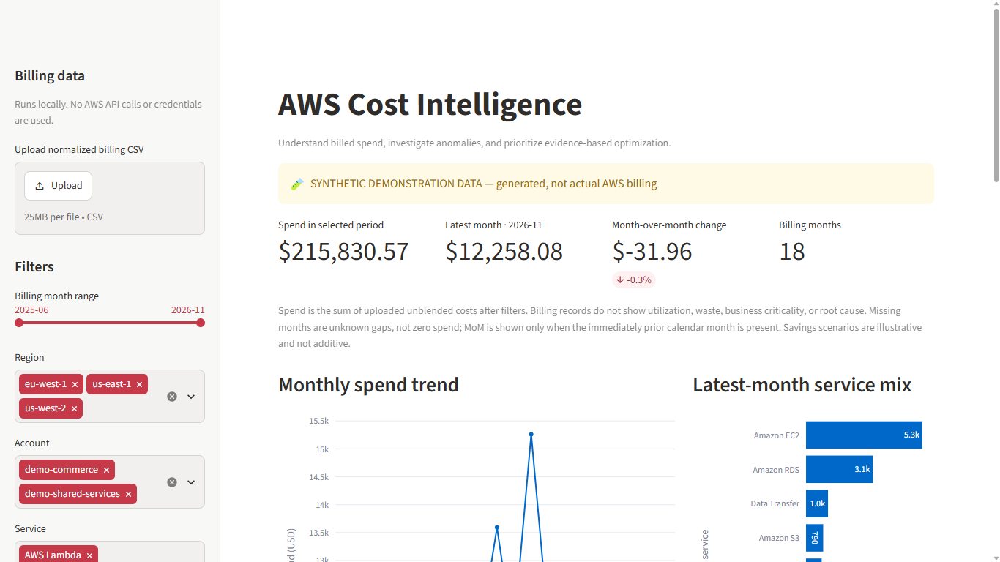
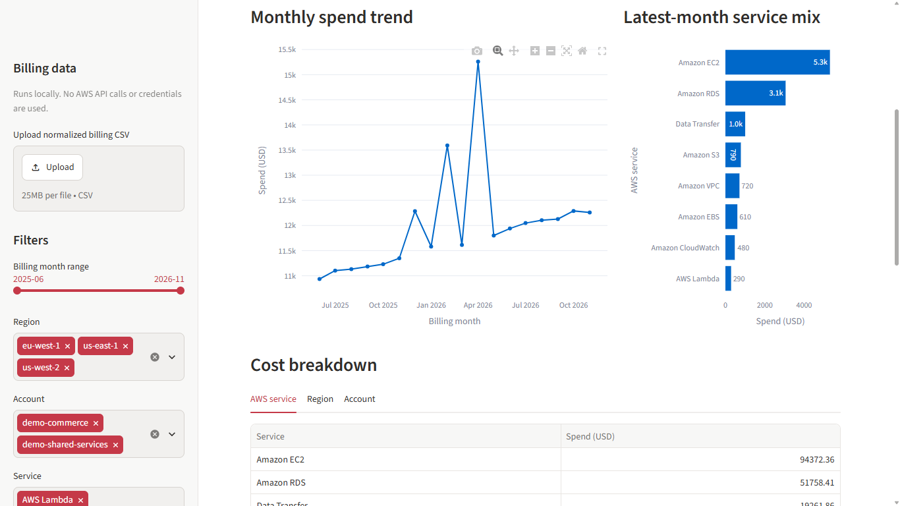
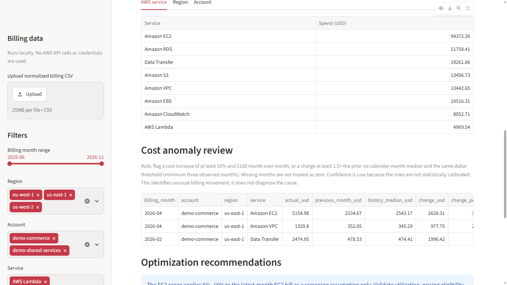
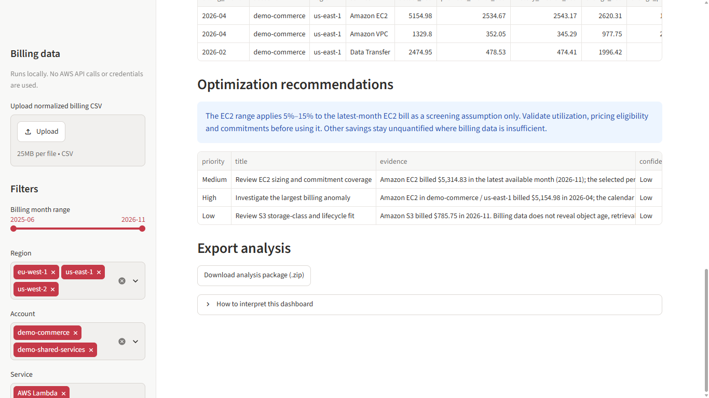

# AWS Cost Optimization Dashboard

A local, portfolio-grade AWS billing analytics dashboard built with Python, Streamlit, Pandas, Plotly and Pydantic. It turns normalized monthly billing records into clear spend trends, explainable anomalies and evidence-led optimization reviews.

> **Sample-data notice:** every checked-in sample billing row is synthetic demonstration data. It does not represent an AWS customer, account, invoice or real usage. The app makes no AWS API calls, provisions no resources and requires no AWS credentials.

## Features

- Executive KPIs for selected-period spend, latest-month spend and month-over-month change.
- Interactive monthly spend trend and service, region and account breakdowns.
- CSV upload with required-column, date and numeric validation and row-specific error messages.
- AWS Cost and Usage Report header aliases for common date, account, region, service, cost and usage columns.
- Explainable anomaly rules: a configurable month-over-month increase and a prior-six-month median comparison, with the values and triggered rule shown.
- Optimization recommendations with evidence, confidence, next steps and explicit savings assumptions. Billing-derived findings are distinguished from items that need utilization, object-age or other telemetry.
- Export package (`.zip`) containing monthly trends, service/region/account breakdowns, anomalies, recommendations and a data-source/limitations note.
- Reproducible 18-month synthetic dataset with deliberate EC2, NAT and data-transfer spikes.

## Run locally on Windows PowerShell

Python 3.11 or newer is required.

```powershell
cd aws-cost-optimization-dashboard
python -m venv .venv
.\.venv\Scripts\python.exe -m pip install --upgrade pip
.\.venv\Scripts\python.exe -m pip install -e ".[dev]"
.\.venv\Scripts\python.exe -m streamlit run app.py
```

Open the local URL printed by Streamlit, usually `http://localhost:8501`. The included synthetic sample loads by default. Upload a normalized CSV to analyze a different billing dataset.

## CSV input schema

Required fields:

| Canonical field | Accepted aliases | Notes |
|---|---|---|
| `billing_month` | `month`, `usage_month`, `line_item_usage_start_date` | Month as `YYYY-MM`, or a parseable date/timestamp (normalized to month). |
| `account` | `account_alias`, `account_id`, `line_item_usage_account_id`, `linked_account_id` | AWS 12-digit account IDs are masked in displayed analysis. |
| `region` | `region_code`, `product_region_code`, `product_region` | AWS Region code or region label. |
| `service` | `service_name`, `product_servicename`, `line_item_product_code` | Common CUR product codes are normalized. |
| `unblended_cost` | `cost`, `line_item_unblended_cost` | Numeric USD amount; signed credits/adjustments are allowed. |
| `currency` (optional) | `currency_code`, `line_item_currency_code` | Defaults to USD when absent; if supplied, every row must be USD. No conversion or mixed-currency aggregation is performed. |

Optional fields include `usage_quantity` (`usage_amount` / `line_item_usage_amount`), `usage_unit` (`unit` / `pricing_unit`) and `usage_type` (`line_item_usage_type`). Extra columns are ignored. CSV uploads are limited to 25 MB and 500,000 rows. If a currency field is included, non-USD and mixed-currency files are rejected. If absent, the data is assumed to already be USD. Export or normalize the AWS CUR/Cost Explorer data to one monthly billing currency before upload; this first version does not reconcile blended/unblended cost, taxes, credits, refunds, Savings Plans or Reserved Instance amortization across different billing views. Duplicate input rows are summed as separate billing lines: there is no safe deduplication without stable source line-item identifiers.

## Tests and quality checks

```powershell
.\.venv\Scripts\python.exe -m pytest
.\.venv\Scripts\ruff.exe check app.py src tests scripts
.\.venv\Scripts\ruff.exe format --check app.py src tests scripts
.\.venv\Scripts\mypy.exe src/aws_cost_dashboard
```

Regenerate the checked-in sample deterministically with:

```powershell
.\.venv\Scripts\python.exe scripts\generate_sample_data.py
```

## Architecture

- `app.py` — Streamlit UI, filters, Plotly views and export interaction.
- `src/aws_cost_dashboard/schemas.py` — CSV header normalization and Pydantic row validation.
- `analysis.py` — cost rollups and executive metrics.
- `anomalies.py` — explainable rule-based spike detection.
- `recommendations.py` — evidence, confidence, telemetry requirements and explicit scenario savings.
- `exports.py` — downloadable ZIP analysis package.
- `sample_data.py` — loads and validates the synthetic dataset.
- `scripts/generate_sample_data.py` — seeded dataset generator.

## Limitations

- This is a billing analytics aid, not an AWS Cost Explorer replacement or a financial forecast.
- Spend and anomaly outputs are derived only from uploaded billing fields. They cannot establish utilization, idle resources, engineering root cause, architecture suitability or achievable savings.
- The EC2 savings range is an illustrative percentage applied to the latest-month EC2 billed cost. It is user-adjustable, is not a price quote or expected result, and is not additive to other recommendations.
- Rightsizing, commitment selection and storage lifecycle changes require service-specific telemetry, pricing terms and operational review.
- Missing calendar months remain unknown gaps in trends and do not act as zero-spend months or MoM comparison periods. The anomaly rule compares MoM only to the immediately prior calendar month; its rolling median uses up to six prior calendar months and requires at least three observed months. Both thresholds are heuristics, and reported confidence is deliberately Low because the rules are not statistically calibrated.
- The built-in anomaly detector is an explainable threshold rule, not statistical/ML root-cause detection. It flags increases only; signed credits and adjustments are retained in totals and can affect aggregated service baselines. The anomaly table is ordered by billing month (newest first), then `change_usd` (largest first); `change_usd` is the month-over-month delta when that comparison exists, or the median deviation when it does not. `anomaly_increase_usd` instead records the largest qualifying increase against a rule that actually triggered, and the highest-priority anomaly recommendation is selected using that field. These measures are intentionally distinct and should not be read as interchangeable rankings.
- The initial schema expects monthly USD amounts and one billing perspective. Currency conversion and CUR-specific amortization semantics are not implemented.
- Synthetic records have deliberately injected anomalies; do not treat them as client requirements or production evidence.

## Visual Evidence

The following supplied screenshots show the dashboard with synthetic demonstration data. They are desktop captures at 1366 × 768. Mobile visual verification is still outstanding. The anomaly review image predates the latest anomaly-ranking correction and does not demonstrate the corrected ranking/table.

### Executive dashboard



### Monthly spend trends



### Anomaly review



### Optimization recommendations


